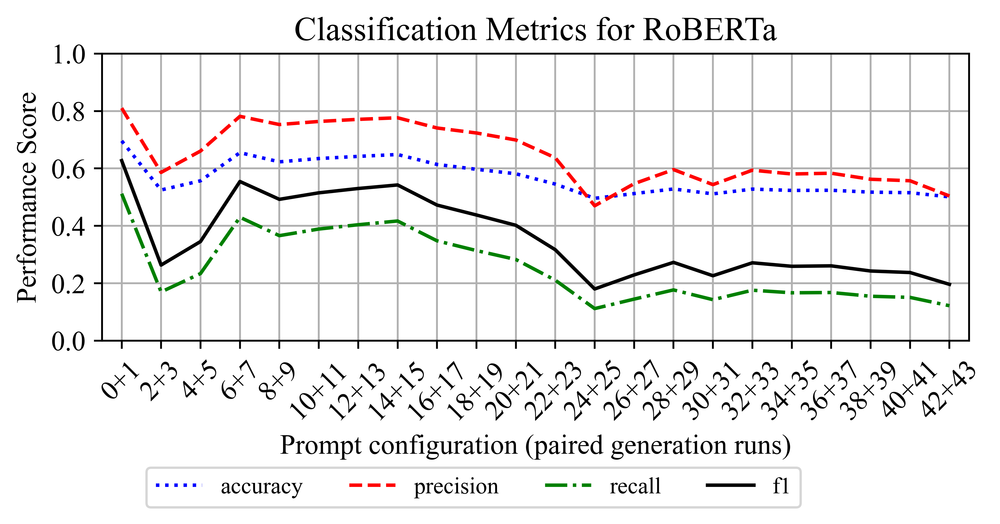

# AI-Generated Fake Review Dataset

This repository contains supplementary material as part of the study:

**Prompting Credibility: Risks of Zero-Shot Prompting and Prompt Engineering for Fake Review Generation**

The study investigates whether **zero-shot prompt engineering** can be used to generate fake online reviews that mimic genuine review characteristics. We use the **Information Manipulation Theory** as an organizing framework, and systematically manipulate textual, readability, sentiment, and temporal prompt constraints to evaluate the similarity (density functions, distance measures, and similarity based on words) between AI-generated fake reviews and genuine Yelp reviews, as well as the impact on fake review detection (Logistic Regression, XGBoost, and RoBERTa). The study comprises **19 prompt engineering experiments**, **376 experimental iterations**, and **235,500 AI-generated fake reviews**. Figure 1 provides an overview of the complete experimental workflow.

  

*Figure 1. Experimental workflow of the study.*

Due to the large number of experimental iterations and AI-generated fake reviews, this repository currently provides the **GPT-generated fake reviews** (GPT-4.1) together with all automatically extracted review metrics and accompanying documentation for the final **Combining Best Practices** experiment, Combining Best Practices.
This experiment combines the best-performing prompt engineering strategies identified throughout the preceding experiments and serves as the final evaluation reported in the manuscript.

For the preceding prompt engineering experiments, the repository provides **some visualizations and brief descriptions of the best-performing constraints** identified for each experiment. These materials document how the final prompt configurations were derived.

The repository therefore provides the AI-generated fake reviews together with all calculated review metrics for each iteration of the **Combining Best Practices** experiment.

---

## Prompting Prerequisites
Although this repository focuses on the main experiments on optimizing review metrics and combining best practices, the key findings of the three experiments on prompting prerequisites are shortly documented in the following because they determined the prompting configuration adopted throughout the entire study.
These three pretests were performed before conducting the main experiments to identify suitable prompting settings: (1) output deviation across identical requests, (2) the maximum feasible number of reviews per API request, and (3) temperature for appropriate balance between diversity, authenticity, and output quality. 
The findings show that deviations across repeated runs were relatively consistent. However, we consider inter-iteration variability throughout the main experiments. Moreover, we use relatively small number of reviews per API request throughout the experiments because large API requests (>200 reviews per rating) frequently returned fewer reviews than requested and showed increasing deviations from genuine reviews. Lastly, temperatures between 0.8 and 1.2 yielded the best overall results. Thus, we use the default temperature value of 1 in all further experiments.

---

## Optimizing Review Metrics

The following 15 experiments systematically examined how textual, readability, sentiment, subjectivity, and temporal constraints affect the characteristics of generated reviews. Best-performing constraints were carried forward to subsequent experiments.

| Experiment | Iterations | Considered metrics / prompt variations |
|---|---:|---|
| **Textual Basics** | 18 | Mean, minimum/maximum, upper/lower quartiles for characters, words, and sentences |
| **Textual Variance** | 12 | Standard deviation |
| **Textual Rating** | 20 | Uniform versus rating-specific parameterization |
| **Textual Syllables** | 18 | Number of syllables, monosyllabic words, and polysyllabic words |
| **Readability Basics** | 40 | Absolute verbal descriptions (very easy, easy, moderately easy, difficult) versus relative descriptions (e.g., easier or slightly easier than reviews with the same star rating) |
| **Readability Index** | 20 | Numerical values for FRES, FKGL, FOG, ARI, LWF, CLI, and DCRS versus verbal interpretation; even versus uneven values; one versus two indices from two correlation groups (ARI and CLI; FOG and CLI) |
| **Readability Rating** | 32 | Uniform versus rating-specific parameterization; with versus without checking and rewriting; one versus two indices |
| **Readability Variance** | 16 | Minimum/maximum and standard deviation; one versus two indices |
| **Sentiment Basics** | 12 | Verbal (marginally more/less positive than is usual for a {rating} star rating) versus numerical addressing polarity|
| **Sentiment Context** | 12 | Simple (Polarity ranges from -1 to 1) versus complex explanation of polarity (e.g., Polarity is a measurement of sentiment. It ranges from -1 to 1. -1 means that a text has very negative sentiment, 0 means a text has neutral sentiment, and 1 means a text has very positive sentiment.); with versus without checking and rewriting |
| **Sentiment Metrics** | 26 | Single versus multiple metrics (sentiment and polarity); with versus without checking and rewriting; explanation of the sentiment range in the system prompt (You are a restaurant customer and you want to give 1 stars. Polarity is a measurement of sentiment. It ranges from -1 to 1. -1 means that a text has very negative sentiment, 0 means a text has neutral sentiment, and 1 means a text has very positive sentiment. Check if generated reviews match the requested sentiment or polarity and rewrite them as necessary.)|
| **Sentiment Combinations** | 22 | Individual sentiment metrics (positive, neutral, negative) versus combinations (e.g., positive, negative, and neutral); with versus without checking and rewriting |
| **Sentiment Variance** | 22 | Dispersion information |
| **Subjectivity** | 10 | Subjectivity value with a simple explanation of the subjectivity range; minimum/maximum and standard deviation; with versus without checking and rewriting |
| **Temporal Information** | 20 | Publication year |

## Textual Metrics
We conducted four experiments on textual metrics. Figure 2 shows that prompting based on mean word or sentence length produced the highest similarity (Iterations 10, 11, 16, 17). 

  

*Figure 2. Textual Basics Experiment. Average cosine TF-IDF similarity between authentic (A) and generated (G) reviews by rating (1–5 stars) for character-level (0–5), word-level (6–11), and sentence-level (12–17) prompts. At each level, two iterations tested minimum and maximum values, upper and lower quartiles, and mean length.*

Figure 3 shows that rating-specific prompts produced greater similarity. 

  

*Figure 3. Textual Rating Experiment. Differences in mean word count between authentic (A) and generated (G) reviews by rating (1–5 stars) for character-level (0–2, 10–12), word-level (3–5, 13–15), and sentence-level prompts (6–8, 16–18). Iterations 0–9 used the same parameterization for all ratings, whereas Iterations 10–19 used rating-specific parameterization. Iterations 9 and 19 combined character-, word-, and sentence-level constraints.*

## Readability Metrics
We conducted four experiments on readability metrics. 
Figure 4 visualizes differences in mean FOG scores under the relative readability instructions (e.g., easier to read than authentic reviews). 

  

*Figure 4. Readability Basics Experiment using relative verbal readability instruction. Mean differences in FOG between authentic and generated reviews. Iterations 0–9 used word-level constraints, and iterations 10–19 used sentence-level constraints for length. Iterations 0, 1, 10, and 11 were baselines without readability instructions. Subsequent iterations requested reviews that were easier (2, 3, 12, 13), marginally easier (4, 5, 14, 15), slightly easier (6, 7, 16, 17), or much easier (8, 9, 18, 19) to read than genuine reviews with the same star rating.*

Figure 5 illustrates that the highest similarity was achieved using a single readability index without the 
checking-and-rewriting system prompt .

  

*Figure 5. Readability Rating Experiment. Mean differences in FOG between authentic and generated reviews. Iterations 0 and 16 were baselines without readability constraints. Iterations 1–15 used the checking-and-rewriting system prompt, whereas Iterations 17–31 did not. Iterations 1–7 and 17–23 targeted a single readability index, whereas Iterations 8–15 and 24–31 targeted two indices simultaneously.*

## Sentiment Metrics
We conducted six experiments on sentiment metrics. 
Figure 6 shows that targeting neutral sentiment, combinations of positive and negative senti-ment, or all three sentiment dimensions produced closer alignment than targeting only positive or negative sentiment. These effects were strongest without the checking-and-rewriting system prompt (Iterations 6–11).

  

*Figure 6. Sentiment Combinations Experiment. Mean differences in composite sentiment scores between authentic and generated reviews. Iterations 0 and 1 served as baselines without sentiment constraints. Subsequent iterations targeted positive (2, 3), negative (4, 5), neutral (6, 7), positive and negative (8, 9), or positive, negative, and neutral (10, 11) sentiment. The constrained configurations from Iterations 2–11 were repeated with a checking-and-rewriting system prompt in Iterations 12–21.*

## Temporal Metrics
Figure 7 shows changes in positive sentiment in genuine Yelp reviews and sentence-level generated reviews. Generated reviews did not reproduce the rating-specific temporal sentiment patterns observed in authentic reviews.

  

*Figure 7 shows changes in positive sentiment in genuine Yelp reviews and sentence-level generated reviews. In genuine reviews, positive sentiment declined over time for 1-star and 2-star reviews, increased for 4-star and 5-star reviews, and remained stable for 3-star reviews, suggesting increasing sentiment polarization. Generated reviews did not reproduce these rating-specific temporal patterns.*

Figure 8 shows that genuine reviews became progressively easier to read, as indicated by a declining average FOG score. Other readability measures, such as the FKGL and ARI, corroborated this trend. Generated fake reviews exhibited the opposite pattern, with FOG, FKGL, and ARI indicating increasing reading difficulty. The opposing trends suggest that the linguistic characteristics of generated fake reviews changed differently over time from those of genuine reviews.

  

*Figure 8. FOG trajectories for authentic Yelp reviews from 2006 to 2015 (left) and generated fake reviews prompted for publication years from 2006 to 2024 (right).*

---

# Final Experiment: Combining Best-performing Constraints

In our final experiment, we tested 11 configurations with and without Meta-Prompting, using two iterations per condition. Each iteration incrementally extends the prompt by incorporating additional best-performing prompt components identified in previous experiments. This resulted in 44 iterations and 22,000 generated reviews. All configurations used rating-specific prompts.
Iterations 0 and 1 served as baselines. Iterations 2–5 incorporated textual constraints, including the mean, minimum, maximum, and standard deviation of sentence count. Iterations 6–11 added readability constraints, initially targeting mean FKGL and then combining FKGL with CLI and adding their minimum, maximum, and standard deviation. Since addressing FKGL alone produced closer alignment, subsequent iterations retained only FKGL. Iterations 12–17 added neutral sentiment constraints, including a verbal explanation and dispersion parameters, while the final two iterations in this block also targeted the mean, minimum, maxi-mum, and standard deviation of subjectivity. Iterations 18–21 additionally specified publication year, using either 2012, a year within the genuine dataset, or 2018, a year outside its range. Itera-tions 22–43 repeated the corresponding configurations from Iterations 0–21 using Meta-Prompting, whereby the model was instructed to revise the prompts for each rating to optimize the requested output characteristics. The table below shows example prompts for generating 5-star reviews in each iteration.

| Iteration | Prompt modification | Example prompt (5-star review) |
|-----------|---------------------|--------------------------------|
| [`combined_prompt_00_gen_sampled.csv`](combined_prompt_00_gen_sampled.csv), [`combined_prompt_01_gen_sampled.csv`](combined_prompt_01_gen_sampled.csv)| Baseline prompt | *Write exactly 10 reviews of a 5-star experience.* |
| [`combined_prompt_02_gen_sampled.csv`](combined_prompt_02_gen_sampled.csv), [`combined_prompt_03_gen_sampled.csv`](combined_prompt_03_gen_sampled.csv) | Average number of sentences | *Write exactly 10 reviews of a 5 star experience. Generate reviews that are on average 7 sentences in length.* |
| [`combined_prompt_04_gen_sampled.csv`](combined_prompt_04_gen_sampled.csv), [`combined_prompt_05_gen_sampled.csv`](combined_prompt_05_gen_sampled.csv) | Average, range, and standard deviation of the number of sentences | *Write exactly 10 reviews of a 5 star experience. Generate reviews that are on average 7 sentences in length and range from 1 to 22 sentences. Reviews must vary in length by 4 sentences.* |
| [`combined_prompt_06_gen_sampled.csv`](combined_prompt_06_gen_sampled.csv), [`combined_prompt_07_gen_sampled.csv`](combined_prompt_07_gen_sampled.csv) | Sentence metrics and average Flesch–Kincaid Grade Level (FKGL) | *Write exactly 10 reviews of a 5 star experience. Generate reviews that are on average 7 sentences in length and range from 1 to 22 sentences. Reviews must vary in length by 4 sentences. The generated reviews must have a Flesch-Kincaid Grade Level of 5.7 on average.* |
| [`combined_prompt_08_gen_sampled.csv`](combined_prompt_08_gen_sampled.csv), [`combined_prompt_09_gen_sampled.csv`](combined_prompt_09_gen_sampled.csv) | Sentence metrics and two readability indices (FKGL and CLI), including means, ranges, and standard deviations| *Write exactly 10 reviews of a 4 star experience. Generate reviews that are on average 8 sentences in length and range from 1 to 28 sentences. Reviews must vary in length by 5 sentences. The generated reviews must have a Flesch-Kincaid Grade Level of 6.3 on average and a Coleman-Liau Index of 7.1 on average. They must range from 0.5 to 10.9 and vary by 1.84 for the Flesch-Kincaid Grade Level. They must range from 1.48 to 13.21 and vary by 1.88 for the Coleman-Liau Index.* |
| [`combined_prompt_10_gen_sampled.csv`](combined_prompt_10_gen_sampled.csv), [`combined_prompt_11_gen_sampled.csv`](combined_prompt_11_gen_sampled.csv) | Sentence metrics (without standard deviation) and FKGL, including mean, range, and standard deviation| *Write exactly 10 reviews of a 5 star experience. Generate reviews that are on average 7 sentences in length and range from 1 to 22 sentences. The generated reviews must have a Flesch-Kincaid Grade Level of 5.7 on average. They must range from 1.9 to 21.2 and vary by 2.47 for the Flesch-Kincaid Grade Level.* |
| [`combined_prompt_12_gen_sampled.csv`](combined_prompt_12_gen_sampled.csv), [`combined_prompt_13_gen_sampled.csv`](combined_prompt_13_gen_sampled.csv) | Sentence metrics and FKGL constraints plus average neutral sentiment | *Write exactly 10 reviews of a 5 star experience. Generate reviews that are on average 7 sentences in length and range from 1 to 22 sentences. The generated reviews must have a Flesch-Kincaid Grade Level of 5.7 on average. They must range from 1.9 to 21.2 and vary by 2.47 for the Flesch-Kincaid Grade Level. Neutral sentiment can range from 0 to 1. The reviews must match a neutral sentiment of 0.7 on average.*|
| [`combined_prompt_14_gen_sampled.csv`](combined_prompt_14_gen_sampled.csv), [`combined_prompt_14_gen_sampled.csv`](combined_prompt_14_gen_sampled.csv) | Sentence and FKGL constraints plus neutral-sentiment mean, range, and standard deviation | *Write exactly 10 reviews of a 5 star experience. Generate reviews that are on average 7 sentences in length and range from 1 to 22 sentences. The generated reviews must have a Flesch-Kincaid Grade Level of 5.7 on average. They must range from 1.9 to 21.2 and vary by 2.47 for the Flesch-Kincaid Grade Level. Neutral sentiment can range from 0 to 1. The reviews must match a neutral sentiment of 0.7 on average.The reviews must vary in neutral sentiment by 0.12 and range from a neutral sentiment of 0.24 to 0.93.* |
| [`combined_prompt_16_gen_sampled.csv`](combined_prompt_16_gen_sampled.csv), [`combined_prompt_17_gen_sampled.csv`](combined_prompt_17_gen_sampled.csv) | Sentence, readability, and sentiment constraints, plus subjectivity mean, range, and standard deviation |*Write exactly 10 reviews of a 5 star experience. Generate reviews that are on average 7 sentences in length and range from 1 to 22 sentences. Reviews must vary in length by 4 sentences. The generated reviews must have a Flesch-Kincaid Grade Level of 5.7 on average. They must range from 1.9 to 21.2 and vary by 2.47 for the Flesch-Kincaid Grade Level. Neutral sentiment can range from 0 to 1. The reviews must match a neutral sentiment of 0.7 on average.The reviews must vary in neutral sentiment by 0.12 and range from a neutral sentiment of 0.24 to 0.93. Subjectivity can range from 0 to 1. The reviews must match a mean subjectivity of 0.6.The reviews must vary in subjectivity by 0.12 and range from a subjectivity of 0.0 to 0.88.*|
| [`combined_prompt_18_gen_sampled.csv`](combined_prompt_18_gen_sampled.csv), [`combined_prompt_19_gen_sampled.csv`](combined_prompt_19_gen_sampled.csv) | Sentence, readability, sentiment, and subjectivity constraints plus temporal prompting (publication year 2012) | *Write exactly 10 reviews of a 4 star experience. Generate reviews that are on average 8 sentences in length and range from 1 to 28 sentences. Reviews must vary in length by 5 sentences. The generated reviews must have a Flesch-Kincaid Grade Level of 6.3 on average. They must range from 0.5 to 10.9 and vary by 1.84 for the Flesch-Kincaid Grade Level. Neutral sentiment can range from 0 to 1. The reviews must match a neutral sentiment of 0.74 on average.The reviews must vary in neutral sentiment by 0.09 and range from a neutral sentiment of 0.35 to 0.92. Subjectivity can range from 0 to 1. The reviews must match a mean subjectivity of 0.58.The reviews must vary in subjectivity by 0.12 and range from a subjectivity of 0.0 to 0.92. Write the review exactly like it was written in 2012.* |
| [`combined_prompt_20_gen_sampled.csv`](combined_prompt_20_gen_sampled.csv), [`combined_prompt_21_gen_sampled.csv`](combined_prompt_21_gen_sampled.csv)| Sentence, readability, sentiment, and subjectivity constraints plus temporal prompting (publication year 2018) | *Write exactly 10 reviews of a 1 star experience. Generate reviews that are on average 9 sentences in length and range from 1 to 23 sentences. Reviews must vary in length by 5 sentences. The generated reviews must have a Flesch-Kincaid Grade Level of 6.1 on average. They must range from 2.1 to 15.0 and vary by 2.21 for the Flesch-Kincaid Grade Level. Neutral sentiment can range from 0 to 1. The reviews must match a neutral sentiment of 0.79 on average. The reviews must vary in neutral sentiment by 0.09 and range from a neutral sentiment of 0.54 to 1.0. Subjectivity can range from 0 to 1. The reviews must match a mean subjectivity of 0.54. The reviews must vary in subjectivity by 0.14 and range from a subjectivity of 0.12 to 1.0. Write the review exactly like it was written in 2018.* |
| [`combined_prompt_22_gen_sampled.csv`](combined_prompt_22_gen_sampled.csv), [`combined_prompt_23_gen_sampled.csv`](combined_prompt_23gen_sampled.csv), [`combined_prompt_24_gen_sampled.csv`](combined_prompt_24_gen_sampled.csv), [`combined_prompt_25_gen_sampled.csv`](combined_prompt_25_gen_sampled.csv), [`combined_prompt_26_gen_sampled.csv`](combined_prompt_26_gen_sampled.csv), [`combined_prompt_27_gen_sampled.csv`](combined_prompt_27_gen_sampled.csv), [`combined_prompt_28_gen_sampled.csv`](combined_prompt_28_gen_sampled.csv), [`combined_prompt_29_gen_sampled.csv`](combined_prompt_29_gen_sampled.csv), [`combined_prompt_30_gen_sampled.csv`](combined_prompt_30_gen_sampled.csv), [`combined_prompt_31_gen_sampled.csv`](combined_prompt_31_gen_sampled.csv), [`combined_prompt_32_gen_sampled.csv`](combined_prompt_32_gen_sampled.csv), [`combined_prompt_33_gen_sampled.csv`](combined_prompt_33_gen_sampled.csv), [`combined_prompt_34_gen_sampled.csv`](combined_prompt_34_gen_sampled.csv), [`combined_prompt_35_gen_sampled.csv`](combined_prompt_35_gen_sampled.csv), [`combined_prompt_36_gen_sampled.csv`](combined_prompt_36_gen_sampled.csv), [`combined_prompt_37_gen_sampled.csv`](combined_prompt_37_gen_sampled.csv), [`combined_prompt_38_gen_sampled.csv`](combined_prompt_38_gen_sampled.csv), [`combined_prompt_39_gen_sampled.csv`](combined_prompt_39_gen_sampled.csv), [`combined_prompt_40_gen_sampled.csv`](combined_prompt_40_gen_sampled.csv), [`combined_prompt_41_gen_sampled.csv`](combined_prompt_41_gen_sampled.csv), [`combined_prompt_42_gen_sampled.csv`](combined_prompt_42_gen_sampled.csv), [`combined_prompt_43_gen_sampled.csv`](combined_prompt_43_gen_sampled.csv) | Same as in Iteration 0-21 | Iterations 22–43 tested the same combinations as Iterations 0–21, but with Meta-Prompting (ses table below), requesting a rewrite of the prompts for star ratings from 1 to 5 to achieve optimal results. |

---
# Meta-Prompting 
The table below show the system prompt for Iteration 42 and Iteration 43, which combine all best practices with Meta-Prompting for generating 5-star reviews. 

| System Prompt | Iteration(s) | Example User Prompt (5-Star Reviews) |
|---|---|---|
| *You are simulating a restaurant customer writing detailed reviews. Your tone should match an enthusiastic, delighted, and highly satisfied experience. All responses should reflect the style of reviews written in 2018.* | [`combined_prompt_42_gen_sampled.csv`](combined_prompt_42_gen_sampled.csv), [`combined_prompt_43_gen_sampled.csv`](combined_prompt_43_gen_sampled.csv) | Write exactly 10 unique restaurant reviews based on a 5-star experience. Use a tone and language style consistent with 2018 online reviews.  Guidelines: -Sentence Count: &nbsp;&nbsp;&nbsp;&nbsp;- Average: 6.85 sentences &nbsp;&nbsp;&nbsp;&nbsp;- Range: 1 to 22 sentences &nbsp;&nbsp;&nbsp;&nbsp;- Must vary by at least 4.27 sentences between reviews -Flesch–Kincaid Grade Level: &nbsp;&nbsp;&nbsp;&nbsp; - Average: 5.66 &nbsp;&nbsp;&nbsp;&nbsp; - Range: 1.90–21.20 &nbsp;&nbsp;&nbsp;&nbsp; - Must vary by at least 2.47 points -Neutral Sentiment: &nbsp;&nbsp;&nbsp;&nbsp; - Mean: 0.7 &nbsp;&nbsp;&nbsp;&nbsp; - Range: 0.24 to 0.93 &nbsp;&nbsp;&nbsp;&nbsp; - Must vary by at least 0.12 -Subjectivity: &nbsp;&nbsp;&nbsp;&nbsp;- Mean: 0.6 &nbsp;&nbsp;&nbsp;&nbsp;- Range: 0.00 to 0.88 &nbsp;&nbsp;&nbsp;&nbsp;- Must vary by at least 0.12  Ensure all reviews sound natural, match the specified tone, and align with user-written content from the specified period. |

---
# Dataset Description
Each CSV file contains the GPT-generated reviews together with calculated metrics during the experiments.

| Variable | Description |
|----------|-------------|
| rating | Target star rating (1–5) |
| review | GPT-generated review |
| num_char | Number of characters |
| num_words | Number of words |
| num_sentences | Number of sentences |
| avg_sentence_length | Average sentence length |
| syllables | Number of syllables |
| FKGL | Flesch–Kincaid Grade Level |
| FRES | Flesch Reading Ease Score |
| FOG | Gunning Fog Index |
| CLI | Coleman–Liau Index |
| ARI | Automated Readability Index |
| DCRS | Dale–Chall Readability Score |
| polarity | Sentiment polarity |
| subjectivity | Subjectivity score |
| positive | Positive sentiment |
| neutral | Neutral sentiment |
| negative | Negative sentiment |
| prediction_lr | Logistic Regression prediction |
| prediction_xgb | XGBoost prediction |
| prediction_roberta | RoBERTa prediction |

---

## Impact on Fake Review Detection
We evaluated whether prompt engineering affected the detection performance of three classifi-ers: Logistic Regression, XGBoost, and RoBERTa.
Logistic Regression and XGBoost were trained under unconstrained baseline training, mean-length-constrained training, and mean-length- and dispersion-constrained training.
Detection performance was averaged across the two independent generation runs for each prompt configuration, resulting in 22 configuration-level observations.

### Detection Performance

Mean ± SD across the 22 prompt configurations.

| Model | Training condition | Accuracy | Precision | Recall | F1 |
|---|---|---:|---:|---:|---:|
| **RoBERTa** | Pre-trained / fixed | .567 ± .061 | .647 ± .103 | .254 ± .121 | .358 ± .139 |
| **Logistic Regression** | Baseline | .515 ± .103 | .339 ± .219 | .062 ± .207 | .077 ± .202 |
|  | Length | .624 ± .096 | .718 ± .105 | .370 ± .192 | .474 ± .178 |
|  | Length + Dispersion | .706 ± .074 | .734 ± .056 | .631 ± .149 | .674 ± .112 |
| **XGBoost** | Baseline | .555 ± .095 | .672 ± .105 | .170 ± .190 | .250 ± .176 |
|  | Length | .794 ± .102 | .890 ± .126 | .645 ± .204 | .736 ± .192 |
|  | Length + Dispersion | .883 ± .031 | .866 ± .009 | .905 ± .062 | .884 ± .035 |

Figures 9 and 10 show detection performance of RoBERTa, Logistic Regression, and XGBoost across prompt configurations.

  

*Figure 9. Fake review detection performance of pretrained RoBERTa.*

  

*Figure 10. Fake review detection performance of Logistic Regression and XGBoost under unconstrained baseline training (a), mean-length-constrained training (c), and mean-length- and dispersion-constrained training (d).*

Figure 11 illustrates cosine similarity between embeddings of authentic and generated reviews (Authentic–Generated) and within the generated reviews (Generated–Generated) across the 44 generation iterations. Authentic–Generated similarity increased substantially after the introduction of textual constraints and remained relatively stable thereafter, while Generated–Generated similarity remained consistently higher, indicating greater within-class semantic similarity among generated reviews.

  

*Figure 11. Evolution of average cosine embedding similarities between authentic and generated reviews and among generated reviews across the 44 iterations.*
